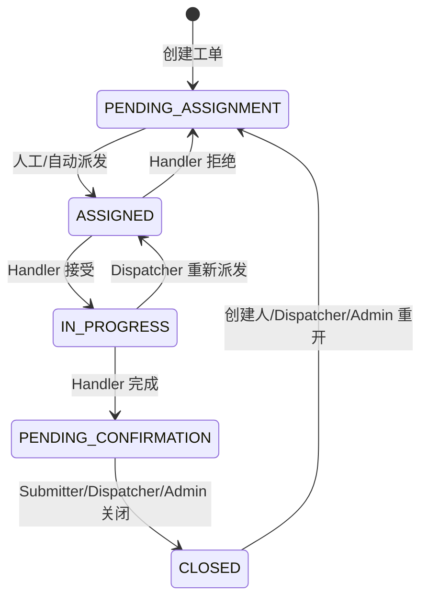
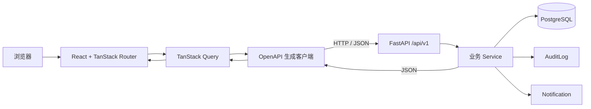
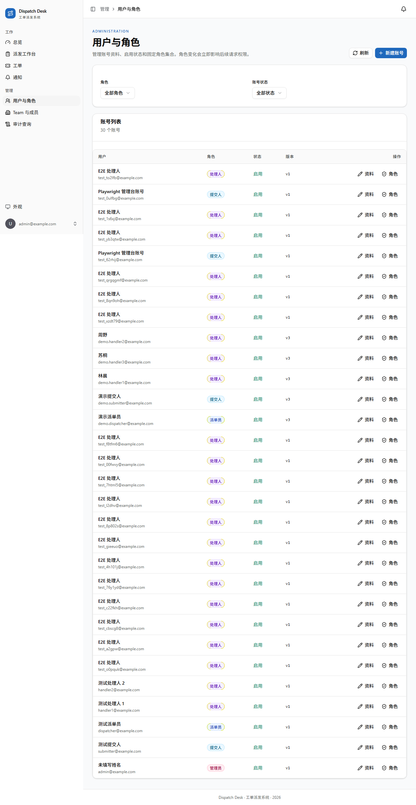
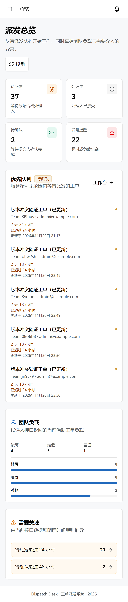

# Dispatch Desk · 工单派发系统

一个面向真实派发场景的全栈工单系统，围绕“提交 → 分诊 → 派发 → 接受 → 处理 → 确认 → 关闭”建立完整业务闭环。

系统以 **Dispatcher（派单员）** 为主视角，同时为 Handler（处理人）、Submitter（提交人）和 Admin（管理员）提供角色化工作区。后端强调权限、事务、并发、幂等和审计；前端提供高信息密度、响应式、明暗主题和可访问的运营控制台体验。


## 项目亮点

- **完整工单生命周期**：创建、编辑、派发、接受、拒绝、完成、关闭和重新打开。
- **人工与自动派发**：支持指定处理人，以及基于最低活动负载的 `LEAST_OPEN_TICKET` 策略。
- **可解释派发结果**：返回候选排名、选中处理人、负载和策略解释。
- **服务端动作权限**：详情返回 `allowed_actions`，前端据此渲染工单动作，后端仍执行最终权限校验。
- **并发保护**：Ticket/Assignment/User/Team 使用期望版本，冲突稳定返回 409。
- **幂等写入**：所有关键写操作要求 `Idempotency-Key`，重复提交不会重复产生副作用。
- **Team 负载公平性**：自动派发在 Team 锁内重新计算候选，避免信任过期预览。
- **治理与审计**：用户、角色、Team 和成员变更具备版本控制、最后管理员约束和审计记录。
- **完整查询能力**：工单、评论、时间线、通知、审计和成员列表使用 opaque cursor 分页。
- **真实前端交付**：响应式布局、明暗主题、加载/空/错误/409 状态、真实浏览器截图和 axe 扫描。
- **契约驱动客户端**：前端 SDK 由 36 端点 OpenAPI 自动生成，不手写复制后端类型。

## 业务角色

| 角色 | 主要能力 |
|---|---|
| `SUBMITTER` | 创建工单、查看本人可见工单、评论、确认关闭、重新打开 |
| `DISPATCHER` | 查看全部工单、人工/自动派发、重新派发、关闭与重新打开 |
| `HANDLER` | 查看当前或历史派发给本人的工单、接受、拒绝、完成 |
| `ADMIN` | Dispatcher 能力以及用户、角色、Team、成员和审计治理 |

一个账号可以拥有多个角色，权限取并集。

## 核心流程



### Dispatcher 主演示链路

```text
派发总览
→ 待派发队列
→ 打开工单
→ 比较候选处理人与负载
→ 人工或自动派发
→ 查看派发解释和最新状态
```

除主链路外，总览还提供：

- 团队负载面板；
- 超时、负载差异等可解释异常；
- 拒绝、重派和 409 冲突恢复路径。

## 技术栈

| 层 | 技术 |
|---|---|
| 后端 | Python 3.14、FastAPI、SQLModel、Pydantic、Alembic |
| 数据库 | PostgreSQL 18 |
| 认证 | JWT、Argon2/Bcrypt 密码哈希 |
| 前端 | React 19、TypeScript 6、Vite 8 |
| 路由 | TanStack Router |
| 服务端状态 | TanStack Query |
| UI | Tailwind CSS 4、Radix UI、shadcn 风格组件、Lucide |
| API 客户端 | OpenAPI + `@hey-api/openapi-ts` |
| 包管理 | uv（后端）、Bun（前端） |
| 测试 | pytest、Vitest、Testing Library、Playwright、axe-core |
| 本地服务 | Docker Compose、PostgreSQL、Mailpit、Adminer |

## 系统架构



### 后端分层

| 层 | 职责 |
|---|---|
| Route | HTTP 输入、依赖注入、状态码和 OpenAPI |
| Schema/Model | 请求、响应和数据库结构 |
| Service | 状态机、事务、权限、派发策略、并发和审计 |
| Repository/Query | SQLModel 查询、行锁和分页 |
| Policy/Guard | 角色、资源可见性、版本和状态转换 |

### 前端分层

| 层 | 职责 |
|---|---|
| `routes/` | URL、搜索参数和页面装配 |
| `features/` | 总览、派发、工单、通知和 Admin 业务 UI |
| `client/` | OpenAPI 生成的 API 服务和类型 |
| `components/ui/` | Button、Dialog、Table 等通用组件 |
| `components/shared/` | 页面头、状态、加载、错误和冲突组件 |
| `hooks/` | 认证和共用 React 逻辑 |

## API 概览

系统固定实现 **36 个契约端点**：

| Tag | 端点数 | 主要内容 |
|---|---:|---|
| Auth | 1 | OAuth2 password flow 登录 |
| Users | 7 | 本人资料、Admin 用户与角色管理 |
| Teams | 7 | Team、成员和可用状态 |
| Tickets | 7 | 创建、列表、详情、编辑、关闭、重开、时间线 |
| Assignments | 7 | 候选、派发、当前派发、历史、接受、拒绝、完成 |
| Comments | 2 | 评论列表和创建 |
| Notifications | 2 | 本人通知列表和详情，只读 |
| Audit | 1 | Admin 审计查询 |
| Health | 2 | live 与 ready |

统一约束：

- API 前缀：`/api/v1`
- 认证：`Authorization: Bearer <JWT>`
- 写操作：`Idempotency-Key`
- 错误结构：稳定 `code`、`message`、`request_id` 和可选 `details`
- 分页：`limit + cursor + next_cursor`
- 并发控制：`expected_*_version`

OpenAPI：

- Swagger UI：`http://localhost:8000/docs`
- JSON：`http://localhost:8000/api/v1/openapi.json`

## 可靠性与安全边界

### 并发

- 派发固定使用“幂等锁 → Team 建议锁 → Ticket 行锁”。
- 接受、拒绝、完成和评论在锁内重新读取最新状态。
- 版本不一致返回 409 `STALE_VERSION`。
- 前端收到 409 后刷新工单、评论、时间线、历史和候选，不自动重放旧请求。

### 幂等

- 同幂等键、同载荷：返回首次结果，不重复产生业务副作用。
- 同幂等键、不同载荷：409 `IDEMPOTENCY_KEY_CONFLICT`。
- 不同幂等键重复派发：由当前状态和版本返回 409。

### 事务与审计

- 业务数据、通知、审计和幂等结果在同一事务中提交。
- 自动派发无候选时写失败审计，但不改变 Ticket、Assignment 或 Notification。
- AuditLog 由数据库 Trigger 禁止普通 `UPDATE` 和 `DELETE`。

### RBAC

- JWT 只包含用户 ID 和过期时间。
- 每次请求从数据库重新加载用户和角色。
- 不可见资源统一返回 404，可见但无权操作返回 403。
- 最后一名有效 Admin 不能被移除或停用。

## 前端体验

### 页面

- 登录
- 角色化总览
- 派发工作台
- 工单列表与筛选
- 工单详情、评论、时间线、派发历史
- 本人通知
- Admin 用户与角色
- Admin Team 与成员
- Admin 审计查询

### 状态

- 骨架加载
- 空状态
- 无权限/不存在状态
- 网络与 5xx 重试
- 409 冲突刷新提示
- 422 字段错误
- cursor 加载更多

### 响应式与可访问性

- 桌面、平板和移动布局
- 浅色、深色和跟随系统
- 键盘可操作 Dialog、Select 和导航
- 状态不只依赖颜色
- 表单关联标签和可读名称
- axe serious/critical 违规为 0

## 截图

### 派发工作台


### 工单详情


### Admin 用户与角色



### 移动端



更多桌面、移动和暗色截图见：

```text
frontend/playwright/screenshots/
```

## 目录结构

```text
ticket-dispatch/
├── backend/
│   ├── app/
│   │   ├── api/routes/       # FastAPI 路由
│   │   ├── services/         # 事务与业务用例
│   │   ├── core/             # 配置、数据库、安全、错误
│   │   ├── alembic/          # 数据库迁移
│   │   ├── models.py         # 数据与 API 模型
│   │   └── scripts/          # 初始演示脚本
│   ├── tests/                # pytest 与契约测试
│   └── pyproject.toml
├── frontend/
│   ├── src/
│   │   ├── client/           # OpenAPI 生成客户端
│   │   ├── routes/           # TanStack Router
│   │   ├── features/         # 业务页面
│   │   ├── components/       # UI 与共享组件
│   │   ├── hooks/
│   │   └── lib/
│   ├── scripts/seed-demo.ts  # 幂等演示数据
│   ├── tests/                # Playwright
│   └── package.json
├── docs/
│   ├── contracts/            # 权威项目契约
│   ├── 项目启动与环境说明.md
│   └── 前端架构与前后端协作入门.md
├── compose.yml
└── README.md
```

## 快速启动

### 环境要求

- Docker Desktop
- uv
- Bun
- Python 3.14（项目 `.venv`）
- PostgreSQL 18（通过 Docker）

### 1. 启动数据库

```powershell
Set-Location E:\Projects\ticket-dispatch
docker compose up -d db mailpit
```

### 2. 安装依赖

```powershell
uv sync --package app
bun install
```

### 3. 准备数据库

```powershell
Set-Location E:\Projects\ticket-dispatch\backend
..\.venv\Scripts\python.exe -m alembic upgrade head
..\.venv\Scripts\python.exe app\initial_data.py
```

### 4. 启动后端

```powershell
Set-Location E:\Projects\ticket-dispatch\backend
..\.venv\Scripts\python.exe -m uvicorn app.main:app --host 127.0.0.1 --port 8000 --reload
```

### 5. 创建演示数据

```powershell
Set-Location E:\Projects\ticket-dispatch\frontend
bun run seed:demo
```

### 6. 启动前端

```powershell
Set-Location E:\Projects\ticket-dispatch\frontend
bun run dev
```

打开：

- 前端：<http://localhost:5173>
- API：<http://localhost:8000>
- Swagger：<http://localhost:8000/docs>
- Mailpit：<http://localhost:8025>

完整启动、可选服务与故障排查：

- [项目启动与环境说明](docs/项目启动与环境说明.md)

## 演示账号

| 角色 | 邮箱 | 密码 |
|---|---|---|
| Dispatcher | `demo.dispatcher@example.com` | `Demo-dispatch-2026!` |
| Handler | `demo.handler1@example.com` | `Demo-dispatch-2026!` |
| Handler | `demo.handler2@example.com` | `Demo-dispatch-2026!` |
| Handler | `demo.handler3@example.com` | `Demo-dispatch-2026!` |
| Submitter | `demo.submitter@example.com` | `Demo-dispatch-2026!` |

Admin 使用根目录 `.env` 中的 `FIRST_SUPERUSER` 和 `FIRST_SUPERUSER_PASSWORD`。

演示账号仅用于本地环境。

## 单端口模式

构建前端：

```powershell
Set-Location E:\Projects\ticket-dispatch\frontend
bun run build
```

构建产物写入 `backend/app/frontend`，启动 FastAPI 后访问：

```text
http://localhost:8000/
```

该模式不需要 Vite，但修改前端后必须重新构建。

## 测试与质量门禁

### 后端

```powershell
Set-Location E:\Projects\ticket-dispatch\backend
..\.venv\Scripts\ruff.exe check app tests
..\.venv\Scripts\ty.exe check --python ..\.venv --project . app
..\.venv\Scripts\pyright.exe --pythonpath ..\.venv\Scripts\python.exe app
..\.venv\Scripts\python.exe -m pytest
..\.venv\Scripts\alembic.exe check
```

### 前端

```powershell
Set-Location E:\Projects\ticket-dispatch\frontend
bunx biome check ./
bun run test:unit
bun run build
bunx playwright test
```

当前基线：

- 后端：147 passed
- 前端单元：10 passed
- Playwright：69 passed，2 个桌面专用用例在移动项目跳过
- axe serious/critical：0

## 设计决策

### Team 是派发队列

Team 不只是组织标签，也是候选人资格边界和派发锁粒度。

### Ticket 不保存当前处理人字段

当前处理人从活动 Assignment 推导，避免 Ticket 与 Assignment 出现双重事实来源。

### 服务端返回 `allowed_actions`

前端不复制状态机和权限组合，只渲染服务端允许的动作。

### 通知只读

当前只提供本人通知列表和详情，不提供已读写入、跨用户查询或外部投递。

### 不使用前端 mock 兜底

演示数据通过真实 API seed 脚本创建，页面始终读取真实服务端数据。

## 当前非目标

- 不提供 Item 业务。
- 不提供通知已读操作。
- 不提供跨用户通知中心。
- 不提供外部邮件、短信或推送投递。
- 不提供全文搜索。
- 不提供 WebSocket 实时推送；修改后通过 Query 失效和重新请求刷新。
- 当前未实现生产密钥轮换和正式部署配置。

## 已知运维注意事项

当前日常开发推荐“Docker 运行 PostgreSQL，本机运行 FastAPI 和 Vite”。

`compose.yml` 的完整 Docker Compose 后端健康检查仍指向旧模板路径，尚未与当前 `/api/v1/health/live` 对齐。因此完整 `docker compose watch` 生产式启动目前不是首选入口。

停止环境时不要使用 `docker compose down -v`，它会删除数据库数据卷。

## 进一步阅读

- [项目启动与环境说明](docs/项目启动与环境说明.md)
- [前端架构与前后端协作入门](docs/前端架构与前后端协作入门.md)
- [开发进度](docs/contracts/开发进度_工单派发系统.md)
- [API 契约](docs/contracts/API_CONTRACT_工单派发系统_v2_2026-11-06.md)
- [架构契约](docs/contracts/ARCHITECTURE_工单派发系统_v3_2026-11-06.md)
- [开发护栏](docs/contracts/DEVELOPMENT_GUARDRAILS_工单派发系统_v1.2_2026-11-08.md)

## License

MIT
