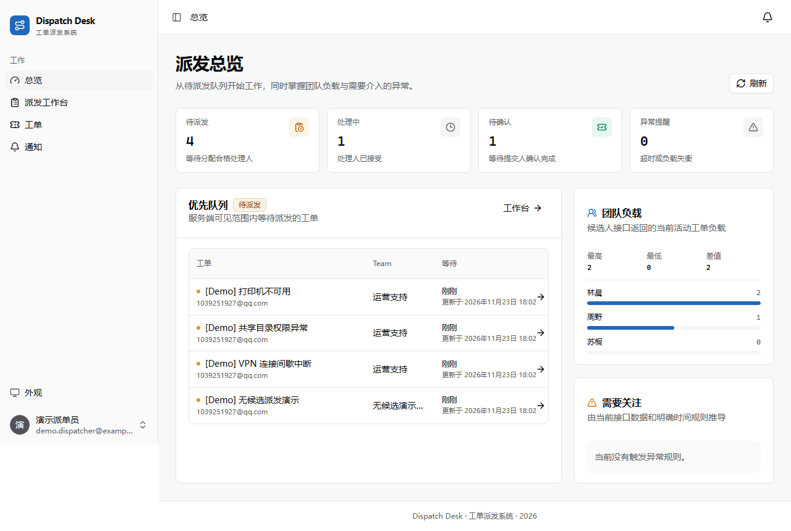
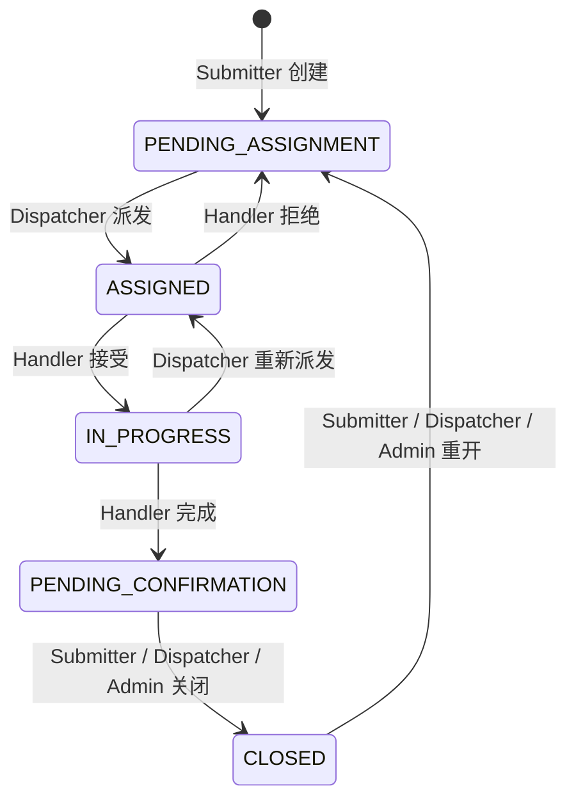
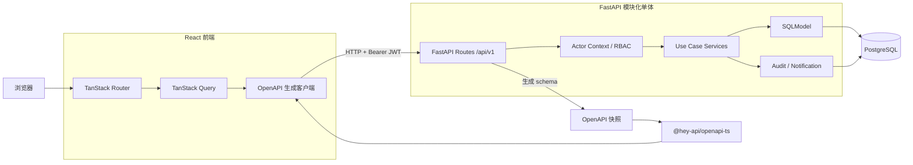
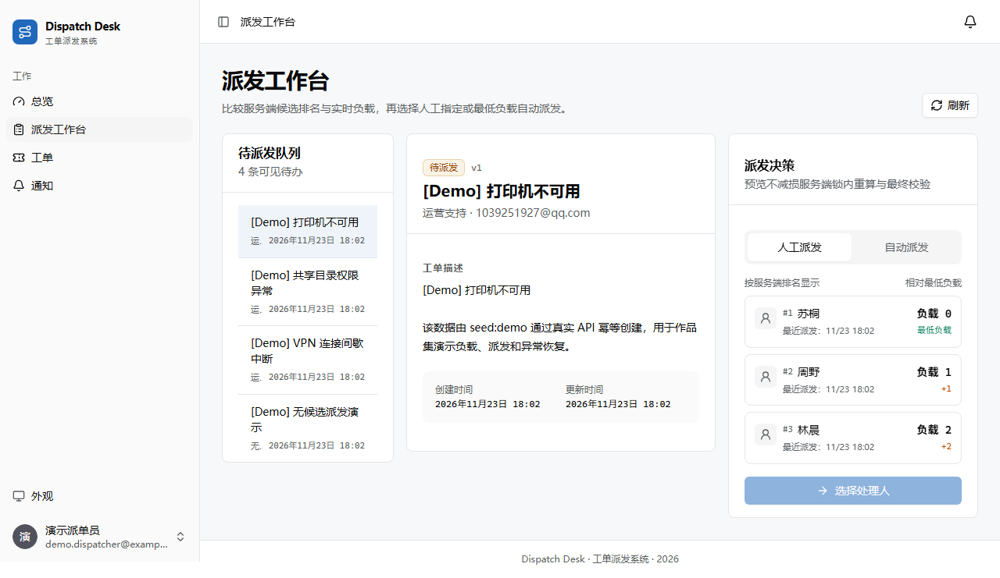
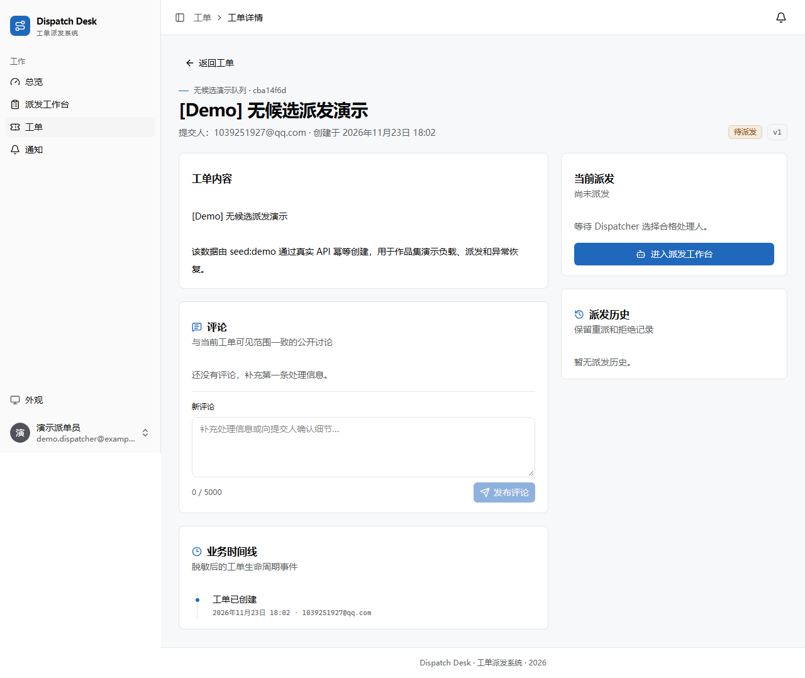
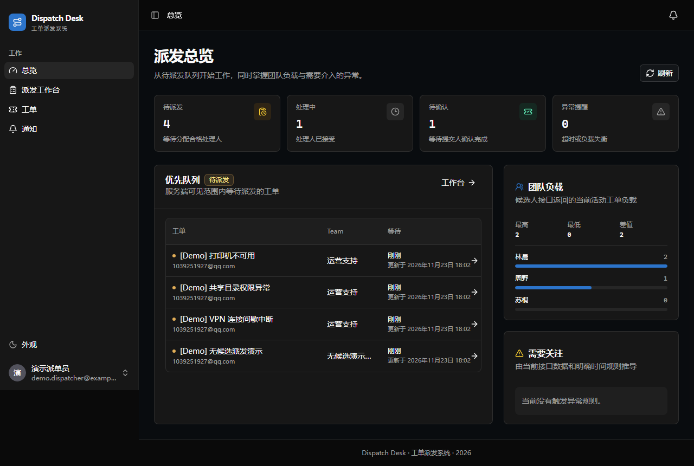

# Dispatch Desk · 工单派发系统

面向内部 IT、运营与共享服务团队的全栈工单派发系统：从提交请求、分诊派发，到处理确认和审计追溯，形成一条可验证的业务闭环。




> 真实 Playwright 截图，页面数据来自本地演示与测试环境。

## 项目定位

普通 Ticket CRUD 只能记录一张工单，无法回答“谁应该处理、为什么派给他、两个人同时派发怎么办、处理完成后如何追溯”。

Dispatch Desk 以 **Dispatcher（派单员）** 为主视角，同时为 Submitter（提交人）、Handler（处理人）和 Admin（管理员）提供角色化工作区。系统围绕以下场景设计：

- 人工指定处理人或按最低活动负载自动派发；
- 同一工单只允许一条有效 Assignment，同时保留完整历史；
- 权限、状态、乐观版本、幂等和审计共同约束写操作；
- 前端收到 `409` 后刷新最新资源，由用户基于新版本重新确认；
- 业务时间线向普通可见用户开放，但不泄露原始审计载荷。

适合第一次接触项目的开发者、代码 Reviewer，以及需要展示业务建模、并发一致性和全栈交付能力的作品集读者。

## 核心能力

| 能力         | 已实现行为                                                      |
| ------------ | --------------------------------------------------------------- |
| 工单生命周期 | 创建、编辑待派发工单、派发、接受、拒绝、完成、关闭、重开        |
| 派发方式     | `MANUAL` 人工指定；`AUTO` 使用 `LEAST_OPEN_TICKET`              |
| 负载公平性   | 按活动负载、最近派发时间、Handler UUID 稳定排序                 |
| 派发解释     | 返回候选排名、选中处理人、活动负载和策略信息                    |
| 权限控制     | 接口级 RBAC 与资源级可见性组合，多角色取并集                    |
| 并发控制     | `expected_*_version`、行锁、Team Advisory Lock 和数据库唯一约束 |
| 幂等写入     | 关键写操作要求 `Idempotency-Key`                                |
| 审计         | 关键成功和失败动作写入 `AuditLog`                               |
| 时间线       | Ticket 创建、评论、派发和状态事件使用脱敏业务摘要               |
| 通知         | 当前用户只读查询站内通知                                        |
| 治理         | Admin 管理用户、角色、Team、成员和审计                          |
| 查询         | Ticket、评论、派发历史、通知、审计均支持 cursor 分页            |

## 角色与权限

| 角色         | 主要职责                                                 |
| ------------ | -------------------------------------------------------- |
| `SUBMITTER`  | 创建本人工单、评论、确认关闭、重新打开                   |
| `DISPATCHER` | 查看全部工单、比较候选、人工/自动派发、重派、关闭与重开  |
| `HANDLER`    | 查看当前或历史派给自己的工单，接受、拒绝、完成并评论     |
| `ADMIN`      | 包含 Dispatcher 能力，并管理账号、角色、Team、成员和审计 |

账号可以拥有多个角色，最终权限取并集。前端根据角色控制导航和动作展示，FastAPI 仍是最终授权边界。

## 业务闭环



一次完整的跨角色演示可以这样进行：

1. Submitter 创建工单，状态进入 `PENDING_ASSIGNMENT`。
2. Dispatcher 查看候选负载，选择人工派发或自动派发。
3. Handler 接受派发并处理；拒绝时工单回到待派发队列。
4. Handler 完成后，工单进入 `PENDING_CONFIRMATION`。
5. Submitter 确认关闭；需要继续处理时可以填写原因重新打开。
6. 关键写操作按契约为相关角色生成站内通知，并同步记录脱敏时间线和审计事件。

## 工程亮点

### 权限隔离

- JWT 只携带用户 ID 和过期时间，角色在每次请求时从数据库重新加载。
- `SUBMITTER` 只能看到本人提交；`HANDLER` 只能看到当前或历史派给自己的工单；`DISPATCHER` 和 `ADMIN` 可查看全部。
- 不可见资源统一返回 `404`，减少资源枚举；可见但无权执行动作返回 `403`。
- 最后一名有效 Admin 不能被停用或移除。

### 事务与审计

- 工单变更、Assignment、Notification、AuditLog 和幂等结果在同一事务中提交。
- 任一通知、审计或幂等结果写入失败时，业务数据整体回滚。
- `AuditLog` 由 PostgreSQL Trigger 禁止普通 `UPDATE` 和 `DELETE`。
- Admin 审计接口只读；公开字段经过受控重建，不直接暴露内部详细载荷。

### 并发与一致性

- 派发固定使用“幂等锁 → Team 建议锁 → Ticket 行锁”的顺序。
- 后端在锁内重新计算候选和负载，不信任前端预览结果。
- Ticket、Assignment、User 和 Team 使用期望版本进行乐观并发控制。
- 版本或状态冲突返回稳定 `409`，客户端不使用旧版本自动重放。
- PostgreSQL 部分唯一索引保证同一 Ticket 最多一条 `ASSIGNED` / `ACCEPTED` Assignment。

### 幂等与冲突恢复

- 同幂等键、同载荷：返回首次保存的状态码和响应体，不重复创建副作用。
- 同幂等键、不同载荷：返回 `409 IDEMPOTENCY_KEY_CONFLICT`。
- 不同幂等键但业务目标已被处理：由状态机、版本和唯一约束返回可解释冲突。
- 前端收到 `409` 后失效工单、评论、时间线、历史和候选查询，保留用户输入并要求重新确认。

### 脱敏时间线

- 业务时间线复用 Ticket 可见性，不会成为管理员审计接口的旁路。
- 只输出白名单事件类型和受控摘要，不返回密码、JWT、原始审计 detail 或工单正文。
- 原始审计查询仅对 Admin 开放，并与业务时间线保持独立权限边界。

## 系统架构



系统采用**模块化单体**，不引入微服务、消息总线或工作流引擎：

- **React + TanStack Router** 管理页面、URL 筛选和路由权限。
- **TanStack Query** 管理服务端状态、分页和失效刷新。
- **OpenAPI 生成客户端**提供按 tag 分组的 TypeScript Service 与类型。
- **FastAPI** 负责 HTTP 契约、认证、错误响应和 OpenAPI。
- **Service** 承载状态机、派发策略、事务、锁、审计和幂等。
- **SQLModel + PostgreSQL** 提供持久化、CHECK、唯一约束、行锁和审计不可变保护。

开发时 Vite 与 FastAPI 分别运行；构建后 Vite 产物写入 `backend/app/frontend`，由 FastAPI 同域托管。

## 技术栈

| 层         | 技术                                                  |
| ---------- | ----------------------------------------------------- |
| 后端       | Python 3.14、FastAPI、SQLModel、Pydantic、Alembic     |
| 数据库     | PostgreSQL 18                                         |
| 认证       | JWT、Argon2 / Bcrypt                                  |
| 前端       | React 19、TypeScript 6、Vite 8                        |
| 路由与状态 | TanStack Router、TanStack Query                       |
| UI         | Tailwind CSS 4、Radix UI、shadcn 风格组件、Lucide     |
| API 客户端 | OpenAPI、`@hey-api/openapi-ts`                        |
| 包管理     | uv（Python workspace）、Bun（前端 workspace）         |
| 测试       | pytest、Vitest、Testing Library、Playwright、axe-core |
| 本地服务   | Docker Compose、PostgreSQL、Mailpit、Adminer          |

## 前端设计成果

界面采用面向运营控制台的 **Signal Desk · Signal Ledger** 设计语言：低阴影、细边界、语义状态色和等宽数字。主操作、等待时长与状态信息优先，避免将业务系统做成营销仪表盘。

本轮视觉收口以 Dispatcher 主链路为中心：优先队列直接显示等待时长与超时状态；派发工作台在桌面比较候选负载、最近派发和相对差值，在移动端使用“队列 / 详情 / 派发”分段流程；409 展示刷新前后版本差异，422 聚焦字段错误摘要。

| 派发工作台                                                           | 工单详情                                                                |
| -------------------------------------------------------------------- | ----------------------------------------------------------------------- |
|  |  |

| 移动端总览                                                                                            | 暗色主题                                                                |
| ----------------------------------------------------------------------------------------------------- | ----------------------------------------------------------------------- |
|  |  |

### 页面范围

- `/login`：OAuth2 password flow 登录。
- `/`：角色化工作总览与 Dispatcher 负载观察区。
- `/dispatch`：待派发队列、候选比较、人工派发、自动派发和派发解释。
- `/tickets`：URL 驱动的筛选、排序和 cursor 分页。
- `/tickets/{ticketId}`：工单内容、评论、时间线、当前派发、历史派发和允许动作。
- `/notifications`：当前用户通知，支持筛选和分页。
- `/admin/users`：用户、启用状态和角色管理。
- `/admin/teams`：Team、成员和可用状态管理。
- `/admin/audit`：Admin 只读审计查询。

### 状态与可访问性

- 统一提供骨架加载、空状态、错误状态、无权限状态、404 和 `409` 冲突提示。
- 桌面端采用侧栏和宽屏数据布局；移动端使用抽屉导航、卡片式信息行和派发分段工作流。
- 工单筛选使用紧凑工具条、可移除条件标签和可展开高级条件；宽表只在表格容器内部横向滚动。
- Audit 先展示可读动作、实体、结果和 Request ID，再按需展开原始 JSON。
- 支持浅色、深色和跟随系统三种主题。
- 表单控件带标签，图标按钮带可读名称，状态同时使用文字与颜色表达。
- Dialog、Select 和菜单基于 Radix UI，保留键盘操作与焦点管理能力。
- axe 自动化扫描覆盖主要页面与移动视口，最近验收记录为 serious / critical 违规 0。

Playwright 已验证 Desktop Chromium、Pixel 5 移动视口和明暗主题；Signal Ledger 收口另以真实浏览器检查了 1024px 双栏、表格内部滚动和 390px 首屏信息位置。

## 本地启动

### 环境要求

- Windows PowerShell
- Docker Desktop
- [uv](https://docs.astral.sh/uv/)
- [Bun](https://bun.sh/)
- Python 3.14，依赖安装到项目根目录 `.venv`

以下流程使用项目指定的 `.venv`，不向全局 Python 安装业务包。

### 1. 准备配置

```powershell
Set-Location E:\Projects\ticket-dispatch
Copy-Item .env.example .env
```

在根目录 `.env` 中配置本地值，至少关注：

- `PROJECT_NAME`
- `SECRET_KEY`
- `FIRST_SUPERUSER`
- `FIRST_SUPERUSER_PASSWORD`
- `POSTGRES_PASSWORD`
- `DATABASE_URL`

同时确认 `frontend/.env` 中的 `VITE_API_URL` 指向本地 FastAPI。README 不展示任何真实密钥、密码、JWT 或数据库连接串；根目录 `.env` 不入库。

### 2. 启动 PostgreSQL 与依赖

```powershell
Set-Location E:\Projects\ticket-dispatch
docker compose up -d db
uv sync --package app
bun install
```

需要查看本地邮件或数据库时，可再启动可选服务：

```powershell
docker compose up -d mailpit adminer
```

### 3. 执行迁移并创建初始管理员

```powershell
Set-Location E:\Projects\ticket-dispatch\backend
..\.venv\Scripts\python.exe -m alembic upgrade head
..\.venv\Scripts\python.exe app\initial_data.py
```

### 4. 启动后端

在独立终端执行：

```powershell
Set-Location E:\Projects\ticket-dispatch\backend
..\.venv\Scripts\python.exe -m uvicorn app.main:app --host 127.0.0.1 --port 8000 --reload
```

### 5. 创建演示数据

后端启动后，在另一个终端执行：

```powershell
Set-Location E:\Projects\ticket-dispatch\frontend
bun run seed:demo
```

该脚本通过真实 API 幂等创建运营 Team、Dispatcher、Handler、Submitter，以及覆盖派发、拒绝、处理中、待确认和关闭状态的演示工单，不使用前端 mock。

### 6. 启动前端

```powershell
Set-Location E:\Projects\ticket-dispatch\frontend
bun run dev
```

本地地址：

- 前端：<http://localhost:5173>
- FastAPI：<http://localhost:8000>
- Swagger UI：<http://localhost:8000/docs>
- Mailpit：<http://localhost:8025>
- Adminer：<http://localhost:8080>

停止服务时使用 `docker compose stop db mailpit adminer`。不要使用 `docker compose down -v`，它会删除本地数据库数据卷。

### 单端口模式

```powershell
Set-Location E:\Projects\ticket-dispatch\frontend
bun run build
```

构建产物写入 `backend/app/frontend`，启动 FastAPI 后访问 <http://localhost:8000>。修改前端后需要重新构建。

## 登录与演示账号

- Admin 使用根目录 `.env` 中的 `FIRST_SUPERUSER` 和 `FIRST_SUPERUSER_PASSWORD`。
- Dispatcher、Handler 和 Submitter 由 `frontend/scripts/seed-demo.ts` 幂等创建。
- 演示凭据仅用于本地环境；README 不复制密码，使用前请查看本地种子脚本。
- `seed:demo` 需要可用的数据库、FastAPI 和后端管理员账号。

## API 范围

OpenAPI 快照固定为 **27 个 path、36 个 operations**：

| 分组          | Operations | 主要内容                                   |
| ------------- | ---------: | ------------------------------------------ |
| Auth          |          1 | 登录                                       |
| Users         |          7 | 本人资料、Admin 用户与角色                 |
| Teams         |          7 | Team、成员与可用状态                       |
| Tickets       |          7 | 创建、列表、详情、编辑、关闭、重开、时间线 |
| Assignments   |          7 | 候选、派发、当前/历史、接受、拒绝、完成    |
| Comments      |          2 | 评论列表与创建                             |
| Notifications |          2 | 本人通知列表与详情，只读                   |
| Audit         |          1 | Admin 审计查询                             |
| Health        |          2 | live 与 ready                              |

通用约束：

- API 前缀：`/api/v1`
- 认证：`Authorization: Bearer <JWT>`
- 关键写请求：`Idempotency-Key`
- 并发保护：`expected_ticket_version`、`expected_assignment_version`、`expected_user_version` 或 `expected_team_version`
- 错误：稳定 `code`、`message`、`request_id` 和可选 `details`
- 分页：`limit + cursor + next_cursor`
- 状态变化只能通过显式 action 接口完成，客户端不能直接提交 `status`

Swagger UI 提供本地交互式 API 文档：

- <http://localhost:8000/docs>
- <http://localhost:8000/api/v1/openapi.json>

提交的契约快照位于 `backend/tests/contracts/openapi.json`。前端服务与类型位于 `frontend/src/client`，由 `@hey-api/openapi-ts` 按 tag 生成；后端契约变化时应同步更新快照和客户端。

## 目录结构

```text
ticket-dispatch/
├── backend/
│   ├── app/
│   │   ├── api/routes/       # FastAPI 路由与 HTTP 契约
│   │   ├── services/         # 工单、派发、治理、幂等和查询用例
│   │   ├── core/             # 配置、安全、数据库、错误与种子
│   │   ├── alembic/          # PostgreSQL 迁移
│   │   ├── models.py         # SQLModel 与公开 API 模型
│   │   └── main.py           # FastAPI 应用装配
│   └── tests/
│       ├── api/routes/       # 权限、契约、状态机和并发测试
│       ├── models/           # CHECK、索引、Trigger 与迁移测试
│       └── contracts/        # 固定 OpenAPI 快照
├── frontend/
│   ├── src/
│   │   ├── client/           # OpenAPI 生成客户端
│   │   ├── routes/           # TanStack Router 页面入口
│   │   ├── features/         # 总览、派发、工单、通知和 Admin
│   │   ├── components/       # 通用 UI、应用壳和状态组件
│   │   └── hooks/            # 认证与共享 React 逻辑
│   ├── scripts/seed-demo.ts  # 通过真实 API 创建确定性演示数据
│   ├── tests/                # Playwright、axe 与截图捕获
│   └── playwright/screenshots/
├── compose.yml
├── .env.example
├── pyproject.toml
└── README.md
```

## 测试与质量门禁

### 后端

从 `backend` 目录执行：

```powershell
..\.venv\Scripts\ruff.exe check app tests
..\.venv\Scripts\ty.exe check --python ..\.venv --project . app
..\.venv\Scripts\pyright.exe --pythonpath ..\.venv\Scripts\python.exe app
..\.venv\Scripts\python.exe -m pytest
..\.venv\Scripts\alembic.exe check
```

### 前端

从 `frontend` 目录执行：

```powershell
bunx biome check ./
bun run test:unit
bun run build
bunx playwright test
```

`playwright test` 包含会覆盖 `frontend/playwright/screenshots/` 的截图捕获用例。只做行为回归、不希望修改受 Git 跟踪的图片时，可执行：

```powershell
bunx playwright test --grep-invert "capture"
```

Playwright 需要 PostgreSQL、FastAPI 和可用的演示数据。当前仓库的 E2E 与视觉捕获需要按本地环境配置运行，并使用独立测试数据，避免污染开发库。

### 最近验收基线

2026-11-23 的 Signal Ledger 验收记录：

| 范围                    | 结果                               |
| ----------------------- | ---------------------------------- |
| 后端 pytest             | 161 passed                         |
| 前端 Vitest             | 29 passed                          |
| Playwright              | 74 passed，5 intentionally skipped |
| axe serious / critical  | 0                                  |
| Ruff / ty / Pyright     | 通过                               |
| Alembic                 | 无待生成迁移                       |
| TypeScript + Vite build | 通过                               |

这些数字是特定提交上的验收快照，不是永久性能或容量指标。

### 测试矩阵

| 范围         | 主要断言                                         |
| ------------ | ------------------------------------------------ |
| 认证与 RBAC  | 四类角色、多角色并集、停用账号、401/403/404 边界 |
| 工单         | 可见性、创建、编辑、评论、版本冲突、幂等重放     |
| 派发         | 人工/自动候选、负载公平性、重派、无候选不变更    |
| 生命周期     | 接受/拒绝竞争、完成、关闭/重开、已被替代记录     |
| 事务         | 通知/审计/幂等失败时整体回滚                     |
| 数据库       | CHECK、部分唯一索引、外键、AuditLog Trigger      |
| OpenAPI      | 36 operations、operationId、错误模型和契约快照   |
| 前端         | 导航角色、URL 筛选、候选比较、人工/自动派发、创建到关闭主链 |
| 错误恢复     | 409 版本差异、输入保留、422 字段摘要焦点         |
| 可访问性     | 7 个主要路由 axe serious/critical 扫描           |
| 响应式与主题 | Desktop Chromium、Pixel 5、浅色与深色截图        |

## MVP 边界与生产化缺口

当前定位是**功能完整、已通过自动化验收的演示级全栈 MVP**，不是生产就绪系统。

明确未实现或未验收：

- 通知只读，没有已读写入、跨用户通知中心、邮件、短信或推送投递。
- 没有 WebSocket 实时推送，页面通过 TanStack Query 失效和重新请求刷新。
- 没有全文搜索。
- 没有评论编辑、删除或附件能力。
- 未完成生产密钥轮换、部署、备份恢复、容量测试和长时间稳定性验证。
- 未达到生产安全要求：登录限流、API 配额、安全响应头、锁超时和统一未处理异常仍属于后续工作。
- 完整 Docker Compose 自托管流程尚未按当前契约完成端到端验收。
- Playwright 当前未使用独立测试数据库；运行前应检查测试数据副作用和截图文件变更。

## 项目交接

根目录 `README.md` 是项目总览和唯一权威入口：

- [后端说明](backend/README.md)：本地运行、目录边界、迁移和质量门禁。
- [前端说明](frontend/README.md)：页面结构、API 客户端、设计系统和浏览器测试。
- `docs/contracts/`：API、架构、PRD、开发护栏和进度记录。该目录按项目护栏被 Git 忽略，因此不作为 GitHub 公开链接；在本机开发与交接时直接查看本地文件。
- `frontend/playwright/screenshots/`：真实浏览器截图。

## License

项目采用 [MIT License](LICENSE)，基于 FastAPI Full Stack Template 扩展实现。
